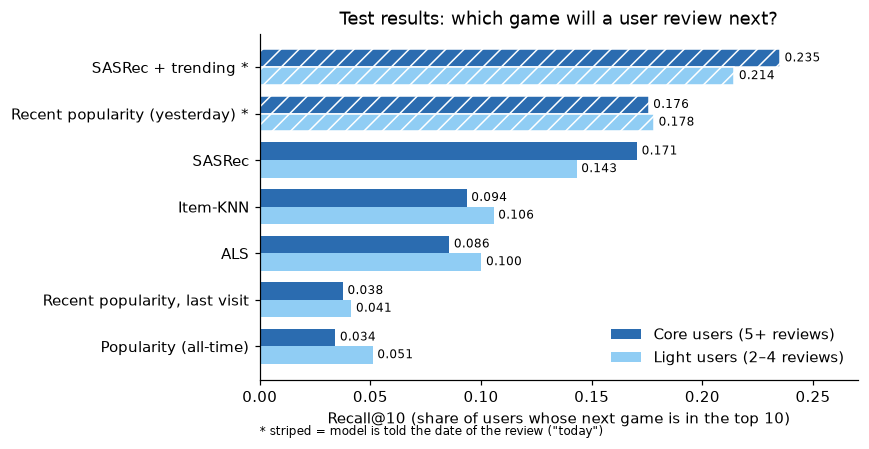
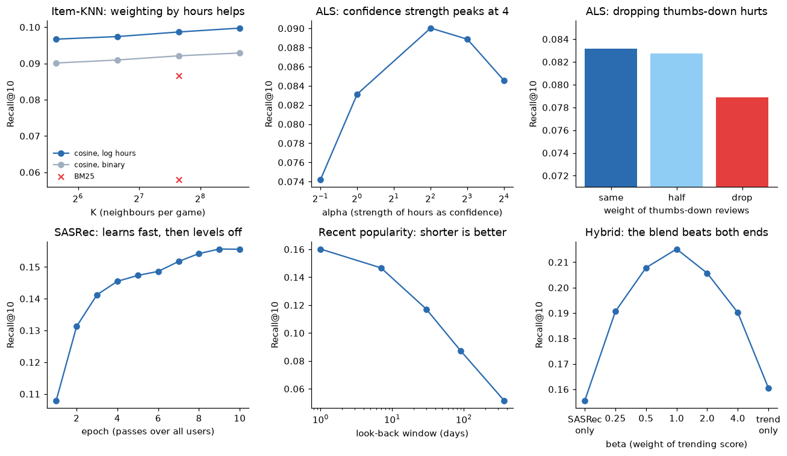

# Steam Game Recommender

**Given a user's history of game reviews, recommend 10 games they are likely to play and review next.**

Built on 41 million Steam reviews from 13.8 million users. Six approaches are compared with one shared evaluation, from a popularity baseline to a transformer that reads each user's games in order (SASRec).



## Key findings

1. **Timing explains a large part of what people review next.** Recommending the games most reviewed *yesterday* puts the user's next game in the top 10 for 17.6% of users. It knows nothing about the user, yet it beats every model that ignores time. All-time popularity, the usual baseline, reaches only 3.4%, so comparing against it alone would overstate the value of personal models by about 5×.
2. **The order of a user's games matters.** SASRec, which reads a user's history as a sequence, reaches 17.1% for users with 5+ reviews, nearly double item-KNN (9.4%) and ALS (8.6%). It gets close to the date-aware baseline without being told the date.
3. **Taste and timing add up.** Blending SASRec with yesterday's trending games gives the best result: **23.5%** for users with 5+ reviews and **21.4%** for users with 2–4 reviews. That is +34% over the trending baseline and +38% over SASRec alone. Personal history adds value on top of what is popular right now.
4. **Hours played is a useful signal, but not a pure measure of enjoyment.** Weighting reviews by log(hours) improved item-KNN by ~7%. At the same time, the share of thumbs-down reviews rises again among players with 600+ hours (see [Playtime and enjoyment](#playtime-and-enjoyment)).

## Results

Test set, 6.2 million users. Recall@10 = share of users whose hidden next game is in the top 10. NDCG@10 also rewards placing it higher in the list.

| Model | Uses date of review | Recall@10 core | Recall@10 light | NDCG@10 core | NDCG@10 light |
|---|:-:|--:|--:|--:|--:|
| Popularity (all-time) | | 0.034 | 0.051 | 0.017 | 0.025 |
| Recent popularity, from last known review | | 0.038 | 0.041 | 0.019 | 0.020 |
| ALS (matrix factorisation) | | 0.086 | 0.100 | 0.045 | 0.056 |
| Item-KNN | | 0.094 | 0.106 | 0.050 | 0.059 |
| SASRec (transformer) | | 0.171 | 0.143 | 0.095 | 0.078 |
| Recent popularity (yesterday) | ✓ | 0.176 | 0.178 | 0.113 | 0.113 |
| **SASRec + trending** | ✓ | **0.235** | **0.214** | **0.151** | **0.134** |

*Core* = users with 5+ reviews (1.9M), *light* = users with 2–4 reviews (4.3M). Random guessing scores about 0.0003.

"Uses date of review" means the model is told the day of the hidden review, standing in for "today" when a user opens the app. A live system always knows today's date, but the other models do not get this information, so the two groups are not a like-for-like comparison.

Each model was tuned on a separate validation review before the test set was used. Tuning curves for every model are in [`notebooks/02_results.ipynb`](notebooks/02_results.ipynb):



**Play next vs enjoy.** Every score is also computed only on users whose hidden review is a thumbs-up. Item-KNN and ALS score slightly *higher* there: similar games tend to be liked. Recent popularity scores 9% *lower*, because trending games attract players who try them because of the hype and then leave a thumbs-down.

## Data

[Game Recommendations on Steam](https://www.kaggle.com/datasets/antonkozyriev/game-recommendations-on-steam) (Kaggle, Anton Kozyriev): 41,154,794 reviews (thumbs up/down, hours played, date) of 37,610 games by 13.8M users, October 2010 to December 2022. User IDs are anonymised.

Exploration is in [`notebooks/01_eda.ipynb`](notebooks/01_eda.ipynb). Main points:

- 86% of reviews are positive. Hours played is right-skewed (median 27, mean 101, capped at 1,000 in the source data).
- 55% of users wrote only one review; the top 5,000 games receive 94% of all reviews.
- Users review about 2.5% of the products they own, so the data shows reviewing behaviour, not full playing behaviour.

## Method

### Cleaning and filtering (`src/prepare.py`)

- **Zero-hour thumbs-up reviews are dropped** (105,703 rows). They are mostly free or joke games and do not show real play.
- **21 duplicate user–game pairs** (a collection glitch in December 2021): the latest review is kept.
- **Every review counts as an interaction**, thumbs-up or thumbs-down. A long-played game with a thumbs-down still tells us what kind of games the user plays. Dropping thumbs-down reviews lowered ALS accuracy by ~5%.
- **Users need 2+ reviews and games need 5+**, applied repeatedly until stable. Users with 2–4 reviews are kept because they review after about 3× more hours than heavy reviewers, so their signal is valuable.
- Result: 33.5M reviews, 6.2M users, 35,070 games.

### Evaluation (`src/evaluate.py`)

- **Leave-last-out:** each user's last review is hidden for testing. For users with 5+ reviews, the second-last review is hidden for validation and used to choose settings.
- **Full ranking:** the hidden game is ranked against all ~35,000 games the user has not reviewed, not against a small sample of random games. Sampled evaluation is known to inflate scores and can change which model looks best.
- One shared script scores every model, so all numbers are directly comparable.

### Models

| Model | Idea | File |
|---|---|---|
| Popularity | Most-reviewed games overall | `src/baselines.py` |
| Recent popularity | Most-reviewed games in the days before the recommendation (best: 1 day) | `src/baselines.py` |
| Item-KNN | Games reviewed by the same people as the user's games; cosine similarity, reviews weighted by log(hours), 400 neighbours | `src/knn.py` |
| ALS | Learns 64 hidden "taste" factors per user and game; hours played sets the confidence of each review | `src/als.py` |
| SASRec | Transformer that reads the user's last 50 games in order and predicts the next one; 2 layers, 64 dimensions, 10 epochs on Apple GPU | `src/sasrec.py` |
| SASRec + trending | SASRec log-probability + log(1 + reviews of the game yesterday) | `src/trend_hybrid.py` |

## Playtime and enjoyment

Long playtime does not always mean a player enjoys a game. In this data, the share of negative reviews falls from 45% (under 1 hour) to 9% (50–100 hours), then rises to 13% beyond 600 hours, most strongly for free-to-play games. This pattern is consistent with the sunk cost effect, the tendency to keep going once money, time or effort has been invested (Arkes & Blumer, 1985), and with research linking obsessive passion for online games to more time played and more negative feelings while playing (Lafrenière et al., 2009). A survey of Call of Duty players likewise found that negative game experience rose with total playtime and that in-game spending rose with time played (Kloska, 2021). The data shows a correlation, not a cause: in-game spending and players' reasons are not visible. It motivated testing lower confidence for negative reviews in ALS: halving it made no meaningful difference (Recall@10 0.0827 vs 0.0831), while leaving negative reviews out lowered it by about 5% (0.0789), so negative reviews still carry useful signal about a player's tastes.

## Limitations

- **Scores measure "next game reviewed", not enjoyment.** 84% of hidden test reviews are positive, so the two are close, but not the same.
- **Only reviewers are in the data.** People who play without reviewing are missing (selection bias), so results apply to reviewers.
- **Global time leakage.** The split is per user, so other users' training reviews can be dated after a test review. The two recent-popularity models only count reviews before the test date, but item-KNN, ALS and SASRec are trained on all training reviews.
- **Same-day order is uncertain.** About 4% of user-days contain several reviews; their order is set by review ID, which is not chronological.
- **Date-aware models know the day of the hidden review.** This matches "today" in a live app, but makes them not directly comparable with the other models.
- **Data ends in 2022** and user IDs are anonymised, so newer games and Steam profile data cannot be added for these users.

## Reproduce

Requires Python 3.11. Developed on an Apple Silicon Mac with 8 GB RAM; SASRec uses the Apple GPU (`mps`) when available and falls back to CPU otherwise.

```bash
python3.11 -m venv .venv
source .venv/bin/activate
pip install -r requirement.txt
```

Download the data with a [Kaggle API token](https://www.kaggle.com/docs/api):

```bash
kaggle datasets download antonkozyriev/game-recommendations-on-steam -p data/raw --unzip
```

Run each step from the project folder. Times are on the 8 GB Mac.

| Step | Command | Time |
|---|---|---|
| Convert CSV to parquet | `python src/convert_parquet.py` | a few minutes |
| Clean, filter, split | `python -m src.prepare` | ~2 min |
| Popularity | `python -m src.baselines` | ~25 min |
| Recent popularity (tune + test) | `python -m src.baselines --recent` | ~40 min |
| Item-KNN (tune + test) | `python -m src.knn` | ~20 min |
| ALS (tune + test) | `python -m src.als` | ~4 h |
| SASRec (epoch curve + test) | `python -m src.sasrec --epochs 10` | ~4 h |
| SASRec + trending (needs saved SASRec) | `python -m src.trend_hybrid` | ~2 h |

Every model writes its test scores to `results/results.csv` and its tuning table to `results/*_tuning.csv`. `notebooks/02_results.ipynb` turns these into the tables and charts above.

## Repository structure

```
├── data/raw/            Kaggle files (not committed)
├── data/processed/      parquet files (not committed)
├── notebooks/
│   ├── 01_eda.ipynb     data exploration
│   └── 02_results.ipynb results and tuning charts
├── src/                 data preparation, models and shared evaluation
├── results/             test scores and tuning tables
├── docs/                references and figures
└── requirement.txt
```

## Next steps

- **New games (cold start):** a hybrid that uses game tags and descriptions to recommend games with few or no reviews, evaluated by hiding the reviews of the newest games. Data for games released after 2022 would come from the Steam store API.
- **Unreviewed games:** test on the UCSD Steam dataset whether games a user owns but never reviewed improve recommendations.
- **Demo app** with Gradio.

## References

- Arkes, H. R., & Blumer, C. (1985). The psychology of sunk cost. *Organizational Behavior and Human Decision Processes, 35*(1), 124–140.
- Hu, Y., Koren, Y., & Volinsky, C. (2008). Collaborative filtering for implicit feedback datasets. *IEEE International Conference on Data Mining (ICDM)*, 263–272.
- Kang, W.-C., & McAuley, J. (2018). Self-attentive sequential recommendation. *IEEE International Conference on Data Mining (ICDM)*, 197–206.
- Kloska, M. M. (2021). *Microtransactions and game enjoyment in free-to-play versus paid computer games* [Master's thesis, Tilburg University].
- Krichene, W., & Rendle, S. (2020). On sampled metrics for item recommendation. *Proceedings of the 26th ACM SIGKDD Conference on Knowledge Discovery & Data Mining*, 1748–1757.
- Lafrenière, M.-A. K., Vallerand, R. J., Donahue, E. G., & Lavigne, G. L. (2009). On the costs and benefits of gaming: The role of passion. *CyberPsychology & Behavior, 12*(3), 285–290. https://doi.org/10.1089/cpb.2008.0234
